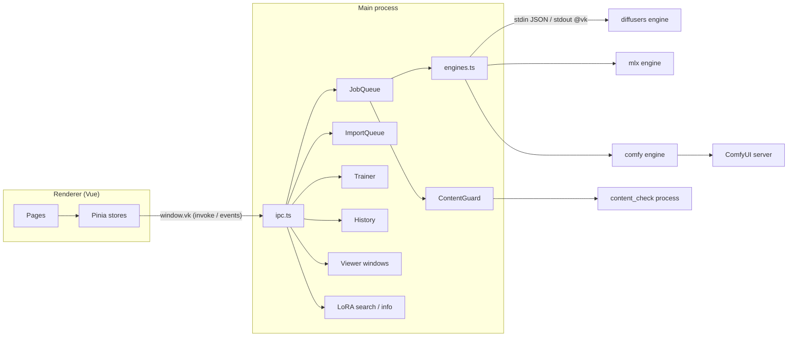

# VulKara developer guide

How the app is built, how its parts talk to each other, how it is tested, and how a release is made.

## Guardrails

Rules every change keeps to. They come from bugs and decisions of the project; a change that breaks one is not done.

### Every change

- **Docs, changelog, commit.** A change to the app updates in the same go: `README.md` and `docs/USER_GUIDE.md` (with a
  new screenshot where the UI changed, in `docs/screenshots/`), this guide where the architecture changed, and
  `CHANGELOG.md` (under *Unreleased* until a release dates it). Then it is committed and pushed. The changelog is shown
  in the app, so it is written for users.
- **Checks green.** `npm run typecheck`, `npm test`, the engine tests (pytest), `npm run check:clean` and
  `npm run check:i18n` pass before a commit. A fix comes with a test for the case that went wrong.
- **Tests are added, not replaced.** Before writing a test file, look whether it exists; add to it. A drop in the
  number of tests is a bug.
- **Commits** describe the change in plain words.

### Small Macs (16 GB)

VulKara has to work on a Mac mini M4 with 16 GB, not only on the 24 GB development Mac.

- Every change to imports, memory plans, SSD streaming, runtime routing or a new model is checked for **16 GB** as
  well: the engine's `LoadedModel` plan, `importer.make_plan` (also for Civitai single files) and the MLX
  `choose_quant`, each with `ram_gb=16`, and a 16 GB case in the tests.
- Live: Settings → *Memory kept free for other apps* = 12 GB gives a 24 GB Mac the 12 GB budget of a 16 GB Mac.
- **MLX can not stream.** A model MLX refuses for memory must go on with Diffusers (`src/main/mlx_fallback.ts`), and
  the job says so in its note. Models only MLX runs (Krea 2, Ideogram 4) need staging (`STAGED_ARCHS`) to fit; FLUX 3 encodes the
  prompt before its transformer loads (`memory.plan(..., staging_frees_denoiser=True)`).
- **GGUF streams too**: `streaming.unpack_gguf` writes a GGUF denoiser's blocks unpacked (16 bit) into the stream
  cache once, block by block, and the other weights into `rest.safetensors`; `unpacked.json` names the file
  (SHA-256) and the dtype. Later loads build the denoiser on the meta device from its config and read only the
  rest, never the GGUF file (diffusers copies a whole GGUF file into RAM). Tests: `tests/test_streaming.py`.
- The import check, the engine and the recommended models (`min_ram_gb`, `min_ram_gb_mlx`, `min_ram_gb_streamed`,
  recomputed with `engines/diffusers/tools/update_curated_ram.py`) must agree on what fits.
- Results are reported for both Macs; what was only planned and not run is called a plan.

### User interface

- **Every text in four languages**: no English text in a page or in a message to the user; it goes through `t()`
  and into English, German, Spanish and Portuguese (see [Translations](#translations)).
- **Hints are badges**, not lines of text: `HintBadge` (`src/renderer/src/components/HintBadge.vue`), whose text opens
  on hover or focus. **ⓘ** (an orange ring, the default) is plain information; **!** (`notice`, a filled orange circle)
  only tells that the app does something differently from the standard or changed something on its own (values that
  differ from the model's suggestion, a replaced sampler, a model that runs streamed). Visible text stays a few words.
  Settings keep their explanations as visible text: little happens there, so nothing is hidden.
- **Details behind an (i)**: what does not fit a tile (full prompt, note, whole error) opens in a panel over it.
- **No `title` tooltips** for information: the system tooltip does not show reliably in the app. Use a panel.
- A panel must not be clipped by its container (in the right-hand panel the badge sits at the right edge), and long
  words wrap (`overflow-wrap: anywhere`).
- Buttons keep their width in narrow panels (`flex: none`); text around them wraps.
- Every job tile, also a cancelled or failed one, can be removed with the **×** in its corner.
- Switching the model keeps steps, guidance, seed and size; only a size the model can not compute changes. The
  model's suggestions are offered (**Model defaults**), never applied silently.
- A UI change is checked in the running app with a real hover or click and a screenshot, not only in code.
- **No emoji in the documents**: README and guides use the app's own Lucide icons, written as SVG files into
  `docs/icons` by `node tools/doc_icons.mjs` (from the app's lucide-vue-next, in the accent colour); a new icon is added
  to its list. Arrows and key symbols (→, ⌘, ⇧, ↩) stay text, as in the app. The changelog stays plain text: the app
  shows it on its Changelog page.
- **Example pictures are labelled**: every picture generated as an example for the app itself (Tips & tricks and the
  like, the helper previews and the README pictures in `docs/images`) carries the EU icon *AI GENERATED* small in its
  lower right corner (the app's size *small*, black or white by the corner), added by `tools/example_picture.py` when
  it is exported from the unlabelled original. The splash picture carries it too (`--label-scale 1.3`, as the window
  shows it smaller). Drawn pictures (a pose skeleton) and the small style previews are not labelled. Pictures users make with the app never
  get this label.

### Engines

- A **stop** belongs to the job read before it: the command reader clears it when the next job is read, never when a
  job starts (a stop sent while an engine starts or loads would be lost).
- LoRA loading must work on quantized models (quanto keeps `x.weight._data`): `_plain_weight_names` in `engine.py`.
- New architectures and LoRA formats are tested with real headers (fixtures) and, before they are called supported,
  with a real picture; until then the docs say *not yet tried with a real picture*.

### Data, models and accounts

- **Never delete the only copy** of a model or LoRA. Removing goes to the Trash; the app never empties it.
- Tokens (Hugging Face, Civitai) live in the keychain and are entered by the user; they are never written to files,
  logs, URLs or tests.
- Accepting a model's licence is the user's action on the model's page; the app links there and does not do it.
- The data of other installations (the earlier app this one replaces) is read for migration, never changed in place.
- Before restarting the app or starting heavy work on the development Mac, the user's running and waiting jobs come
  first.

### Content protection

- The protection of minors is not configurable and is never loosened: the prompt filter, the result filter with its
  thresholds and the consent question stay as they are, whatever the edition or setting. Adult content can be allowed
  in Settings; content involving minors never.

### Releases

- A release is built from the committed state only: work that is not part of it is set aside first, so the DMG holds
  exactly what the tag holds.
- Version in `package.json`, the dated `CHANGELOG.md` section, `tools/release.mjs`, the tag `vX.Y.Z` pushed, and the
  release on GitHub (and on the Gitea mirror) with the DMG and its SHA-256 in the notes.
- Without the notarytool profile the DMG is signed but not notarized; the release notes say so.
- The runtimes' Python packages are locked: every engine requirement is pinned (`==`) and every package of a runtime,
  also the ones that only come in through others and ComfyUI's own, is fixed in `engines/<engine>/constraints.txt`.
  A new version reaches users only through an accepted [dependency update](#dependency-updates) before the release
  build; `tools/release.mjs` refuses to build otherwise (Pillow 13 broke mflux on a fresh install, 0.5.1_hf_1).

### Testing on the development Mac

- A second instance with its own data folder (`--user-data-dir`, `--no-splash`, see [A test instance](#a-test-instance))
  is used for automated checks, never the user's own app; it shares the models folder, so test downloads are named as
  such and removed afterwards.
- Test downloads and caches are removed when the test is done; free disk space is checked before large downloads.

Concepts not built yet are in `docs/concepts/` ([Characters](concepts/CHARACTERS.md)).

## Stack

| Part | Technology |
| --- | --- |
| App shell | Electron 44, electron-vite 5, TypeScript 5.9 |
| Pages | Vue 3.5, Pinia, Vue Router (hash history), lucide icons |
| Tests | vitest (TypeScript), pytest (engines) |
| Engines | Python 3.11 in separate runtimes (uv venvs): diffusers / PyTorch MPS, MLX (mflux), ComfyUI 0.38 with ComfyUI-GGUF |
| Packaging | electron-builder, `@electron/osx-sign`, `@electron/notarize`, notarytool |

## Layout

| Folder | What is there |
| --- | --- |
| `src/main` | Electron main process: windows (main, splash, viewer), engine processes, job queue, runtimes, imports, history, training, LoRA search and descriptions, licences, migrations |
| `src/preload` | The typed bridge between the pages and the main process (`window.vk`) |
| `src/renderer` | The pages (`pages/`), shared components (`components/`), Pinia stores (`stores/`), helpers (`util/`), the splash picture (`assets/splash`) |
| `src/shared` | Types, the page API (`api.ts`), the texts in four languages (`i18n/`), settings, content policy, styles, samplers, ControlNet kinds, LoRA bases and fit, licence terms, editions, data (recommended models, licences) |
| `engines/diffusers` | PyTorch / diffusers engine and the architecture registry (`registry.py`); also imports, previews, pose detection, content filter, photo restoration (`restore.py`, DDColor, LaMa), SSD streaming, the LoRA / model recheck, SDXL training |
| `engines/mlx` | MLX engine (mflux): FLUX, Krea 2, Ideogram 4; FLUX 3 Image Klein with flux3-mlx and its prompt upsampler with mlx-lm (`flux3.py`); training for FLUX.2 [klein] and Krea 2 |
| `engines/comfy` | Runs ComfyUI as a background process for the models only it supports (Anima, Wan) and for upscaling |
| `tools` | Release, dev bundle, licence data, notices, icon, the clean check |
| `build` | Icon and entitlements |
| `docs` | User guide, this guide, screenshots, sample pictures |

## Architecture



- **Pages** call `window.vk.*` (declared in `src/shared/api.ts`, exposed in `src/preload`). Every call is an
  `ipcRenderer.invoke`; changes come back as events (`queue:change`, `history:change`, …).
- **JobQueue** (`src/main/queue.ts`) runs one job at a time. It checks the prompt against the content policy, expands
  `count` into jobs with consecutive seeds, routes each job to its engine, passes every result through the
  **ContentGuard**, records finished jobs in the **History** and sets the *first picture* flag of the Start page.
- **engines.ts** starts one process per runtime when it is first needed, and keeps it running so the loaded model
  stays in memory. Which engine runs a job follows from the model's manifest (`runtime`, family, format) and the
  *Preferred runtime* setting: `krea2` and `ideogram4` only run on MLX, `flux1_schnell`, `flux1_dev` and
  `flux2_klein` in repository layout on MLX or Diffusers, models with `runtime: comfyui` and upscaling on ComfyUI,
  restoration on Diffusers. Changed folders and engine settings restart the engines before the next job.
- **ContentGuard** keeps a long-running `content_check` process of the diffusers runtime. It fails closed: when it is
  not available, no result is shown. Nudity together with a likely minor is always blocked; other nudity only while
  *Allow nudity* is off.
- **Splash** (`splash.ts`, route `#/splash`) is a frameless window (640×384) shown while the main window loads behind it; it
  closes by itself once the main window is ready and it has been shown for 5 s. At start the app sets its own
  `AppleWindowTabbingMode` to `manual`, so macOS (*Prefer tabs: Always*) never tabs the splash or the viewer into the
  main window. `--no-splash` skips it.
- **Viewer windows** (`viewer.ts`) are separate `BrowserWindow`s on the route `#/viewer`. They get their payload
  through a restricted set of IPC channels. Over a main window in full screen a viewer opens as a child window in the
  same space (not a full-screen space of its own), which is why the page has its own close button.

## Engine protocol

One line per message, in both directions.

**Requests** (stdin, JSON):

```json
{"op": "generate", "job": {"model_dir": "…", "prompt": "…", "width": 1024, "height": 1024, "steps": 25, "guidance": 6, "seed": 42}}
```

`op` is one of `generate`, `preview`, `stop`, `unload` and `ping`. An engine works on one job at a time; a reader
thread owns stdin, so `stop` is seen while a job runs. `src/shared/engine_job.ts` turns the job of a page
into the engine's job (LoRAs, control picture, restore options, upscale).

**Events** (stdout, lines starting with `@vk `):

```
@vk {"event": "state", "state": "idle"}
@vk {"event": "status", "message": "Loading the model"}
@vk {"event": "progress", "value": 42}
@vk {"event": "result", "path": "/…/a_lighthouse_123.png"}
@vk {"event": "error", "message": "…"}
```

`state` is `loaded`, `idle` or `busy`; `progress` is a percentage (−1 while unknown); `preview` and `pong` answer
the requests of the same name. Every other output line goes to the log (`log.ts` strips progress bars and ANSI codes,
and tags each line with its source).

The diffusers runtime's `main.py` also has one-shot commands, run as separate processes: `import_model` (the
importer, also its dry run behind **Check**), `previews`, `train`, `hardware`, `detect_pose`, `recheck_loras` and
`content_check`.

## Models and manifests

Each model is a folder in the models folder, with a `model.json` manifest written by the importer: `arch` (a key of
`ARCHS` in `engines/diffusers/registry.py`), `family`, `variant` where the family has sizes, layout and format,
defaults (steps, guidance, size, negative prompt), capabilities (`img2img`, `inpaint`, `negative_prompt`, control
kinds), memory (`components`, `min_ram_gb`, quantization, streaming), an optional `display_name`, `unsupported` for a
model the app recognises but can not run yet, and its source (Hugging Face repository or Civitai version).
`imported_on` notes the Mac of the import: `machine`, the first 16 hex characters of the SHA-256 of its
IOPlatformUUID (computed once by `src/main/foreign_mac.ts`, passed to every engine process as `VK_MACHINE_ID`; the
UUID itself is never written), and `ram_gb`, its memory rounded to whole GB as `Math.round(totalmem() / 1024 ** 3)`
(`importer.imported_on()`). The importer, a bake (`merge.py`) and the one-time FP8 to GGUF conversion write it; a
recheck that plans an old import again keeps the old plan's memory in it. `foreignMac()` takes a model for one of
another Mac when its `machine` differs from this Mac's, else when its memory (`imported_on.ram_gb`, for older
imports `plan.ram_gb`) differs; a model that tells neither counts as this Mac's. `queue:add`, `assets:bake` and
`training:start` refuse such a model; `assets:reimport` moves it to the Trash and imports it again from its source
(`reimportRequest()`: a file or folder that is still there, a Hugging Face repository, a Civitai page) after a dry run.
`src/main/assets.ts` reads the manifests; `src/renderer/src/util/job_form.ts` decides from them which models each page
offers and how the form follows a model switch (`applyModel`: steps, guidance, seed and size kept, a size the model
can not compute changed in the same proportions and restored later (`sizeWanted`), sampler kept; `applyDefaults` for
**Model defaults**).

LoRAs work the same way in the LoRAs folder (`lora.json` with `family`, `variant`, `detected_by`, trigger words). The
description from the LoRA's source page is cached as `info.json` (`src/main/lora_info.ts`), the licence read for a
model or LoRA as `licence.json` (`licence_info.ts`).

### Family ids

| `family` | Architectures (`arch`) | Sub-bases (`variant`) |
| --- | --- | --- |
| `sd1` | `sd15`, `sd15_inpaint` | |
| `sd2` | `sd21`, `sd21_base` | |
| `sdxl` | `sdxl` (LoRA bases `sdxl`, `pony`, `illustrious`, `noobai`) | |
| `sd3` | `sd35_medium`, `sd35_large` | |
| `flux1` | `flux1_schnell`, `flux1_dev` | |
| `chroma` | `chroma` | |
| `flux2` | `flux2_klein`, `flux2_dev` | `klein4b`, `klein9b`, `dev` |
| `qwen_image` | `qwen_image` | |
| `qwen_image21` | `qwen_image21` (needs diffusers 0.41: `packages` in its spec) | |
| `z_image` | `z_image` (Turbo and Base, `MLX_ALSO` for the repository layout; LoRA bases `z_image_turbo`, `z_image_base`) | |
| `krea2` | `krea2` (`runtime: mlx`) | |
| `ideogram4` | `ideogram4` (`runtime: mlx`) | |
| `anima` | `anima` (`runtime: comfyui`) | |
| `wan` | `wan22_ti2v`, `wan22_i2v_14b` (`runtime: comfyui`, `kind: video`) | `5b`, `14b` |

LoRA families without an architecture (`lumina`, `hidream`, `hunyuan_video`, `auraflow` …) are known by
name (`FAMILY_TITLES` in `src/shared/lora_fit.ts`, `FOREIGN_FAMILIES` in the registry), so such LoRAs are filed
correctly and shown, but `loraFits` offers them to no model. Their import label ends in `registry.NO_RUNTIME_LABEL`;
`recheck.py` takes it off once the family has an architecture (as for `z_image`).

Z-Image specifics: Turbo and Base share the architecture and their files look the same, so `registry.is_z_image_base`
decides from the name (with Civitai's base model appended as `name_hint` by `importer.inspect`) or, for diffusers
folders, the scheduler's shift (Base 6, Turbo 3); Base gets `Z_IMAGE_BASE_DEFAULTS` and its single files the base
parts of `undistilled_base_repo`. `guidance_off_at: 1.0` passes guidance 0 to the pipeline for values up to 1
(`engine.pipeline_guidance`), as mflux does; staged prompt embeddings are lists of tensors.

### LoRA detection and fit

`registry.lora_identity` decides a LoRA's family and sub-base: the **structure** of its layers first; where they leave
a choice or tell nothing, its **metadata**; then the **source** hint (Civitai's base model, a Hugging Face
`base_model`). When nothing tells, it raises `UnsupportedModel`; there is no fallback to SDXL. `lora_mismatch` (engine)
and `loraFits` (`src/shared/lora_fit.ts`, pages) refuse a LoRA of another family or sub-base. When loading, the
diffusers engine counts the LoRA's denoiser layers that got the adapter (`_check_applied`): below `MIN_APPLIED` (0.9)
the job fails with *only N % of its layers found their place*.

LoRA files in namings diffusers' readers do not take are converted in one place, `engines/diffusers/lora_convert.py`:
`prepare(pipe, file_or_dict)` is called by every LoRA path of `engine.py` (loading, `_check_applied`, the SSD streaming
path), so the coverage check sees the converted dict. Per pipeline (by its class name): peft dumps (`.default.`,
`base_model.model.`, no component prefix) for all; FLUX.1 / Chroma original (BFL) names with peft factors to kohya's
(`bfl_lora_to_kohya`, Chroma's guidance layers dropped); Qwen-Image 2.1 `img_mlp.gate_up` split into `gate_layer`
(first half of lora_B's rows) and `proj` (`split_gate_up`); Z-Image in any naming other than diffusers' with peft
factors (ComfyUI's fused `attention.qkv` cut into `to_q` / `to_k` / `to_v` by rows, `attention.out`, kohya's, peft dumps)
into `diffusion_model.<layer>.lora_A/B.weight` (`z_image_to_diffusers`, also used by the MLX engine, which writes the
converted copy to a temporary folder and counts its layers against mflux's mapping, `lora_coverage`); SD / SDXL
`lora_transformer_` and `diffusion_model_` keys as `lora_unet_`. `check_format` refuses LyCORIS LoKr / LoHa (no reader in diffusers 0.41) with
`UnsupportedLoraFormat`. Tests: `tests/test_lora_convert.py` (real headers, coverage on meta-device models).

### Imports

`engines/diffusers/importer.py`: `default_name` takes the file's name, or the repository's for generic file names
(`GENERIC_STEMS`); `_reuse_repo_files` and `_existing_base_file` link or copy files another model already has;
`memory.plan` chooses per-component quantization against the RAM minus the reserve and, when nothing fits, a streamed
plan (`streamed`, the 16 bit denoiser block by block from the SSD, `streaming.py`). `engine.keep_plan` then asks the
plan how much of the 16 bit denoiser may stay on the GPU (`STREAM_KEEP_MARGIN` less); `streaming.resident_blocks`
spreads those blocks over the model, the others are read `PREFETCH` blocks ahead with `READERS` reads at a time.
Where the text encoder is staged (16 GB), the kept blocks are released while a new prompt is encoded and read back
after (`release_kept` / `restore_kept`, their LoRAs come off and back on). Step caching (`step_cache.py`, `VK_STEP_CACHE` = light 0.05 / strong 0.12) puts diffusers' First Block Cache on
denoisers whose blocks diffusers knows (`supported`); `run` resets it per picture and opens a cache context for
pipelines without one; the blocks it may skip carry `_step_cache_skippable`, and streaming does not read them while
`_stream_needed` says the run is reused (Z-Image's refiner blocks are not among them). Chroma's pipeline runs guided
and unguided passes without cache contexts, so its blocks stay unhooked. Measured on FLUX.1 [dev], 28 steps, 768 px:
light reuses 5 runs (PSNR 41 dB against off), strong 15 (31 dB). `VK_STREAM_PROFILE=1` logs per image: passes,
GB read, seconds waiting for the SSD / copying / computing, and the GPU memory peak. Measured on an M2 with the cache
on a USB SSD (0.93 GB/s; internal 2.7–3.3 GB/s): at 1024 px streaming is computing-bound (FLUX.1 [dev] 6 % waiting,
Chroma with guidance 1 %), so batching the guided and the unguided pass would save nothing there; at 512 px it is
reading-bound (55–63 % waiting). The streaming cache is
`<model>/stream_cache`, or `<VK_STREAM_CACHE_DIR>/<model>` when *SSD streaming cache* is set (`engineEnv` in
`src/main/settings.ts`). A Hugging Face repository without a full model answers the dry run with *Pick one of its
model files: …*, which the Add tab shows as buttons.

## Development

```bash
npm install
npm run dev          # the app with live reload (dev server origin)
npm run start:app    # build, then run it as "VulKara" from dist/dev/VulKara.app
npm run typecheck    # vue-tsc for the pages, tsc for main and preload
npm test             # unit tests (vitest)
npm run check:clean  # the check against the earlier app
npm run check:i18n   # no page text without t()
```

`npm run start:app` (`tools/dev-app.mjs`) copies Electron's app bundle to `dist/dev/VulKara.app` with VulKara's name,
bundle id and icon, signs it ad hoc and starts it, so the Dock and the menu bar say VulKara. The bundle is made again
when the Electron version changes; arguments after `--` go to the app.

The engines run in runtimes the app installs (Settings → Runtimes) into its data folder. Engine tests run with the
diffusers runtime's Python (or any environment with its packages and pytest):

```bash
~/Library/Application\ Support/VulKara/runtimes/diffusers/venv/bin/python -m pytest engines/diffusers/tests
```

### A test instance

A second instance runs side by side with its own data and without the splash, for example for automated checks over
the Chrome DevTools protocol:

```bash
npm run build
node_modules/.bin/electron . --no-splash --user-data-dir=/tmp/vk-test --remote-debugging-port=9336
```

`--user-data-dir` keeps its settings, history, tokens and runtimes apart from the installed app; point its folders in
Settings at test folders. `--no-splash` goes straight to the main window and keeps automated runs from coming to the
front. The page is `vk-app://bundle/index.html#/…`; `location.hash = '#/models'` switches pages, and `window.vk` is
the same API the pages use.

### Migrations

`src/main/migrate.ts` runs at start:

- `recheckLibrary`: once, `main.py recheck_loras --apply` (`engines/diffusers/recheck.py`) checks every installed LoRA
  and model with the current detection: wrong family, missing sub-base, Chroma checkpoints filed as FLUX.1 or marked
  unsupported, labels of LoRAs whose family became runnable. Each changed manifest is kept as `<manifest>.bak`, every
  change is logged, and the flag file `RECHECK_FLAG` (currently `loras-rechecked-3`) is written in the data folder only after a run that ended well;
  without the Diffusers runtime it waits for a later start. To run it again after a detection change, raise the flag's
  number. `python main.py recheck_loras` without `--apply` prints what would change.

`engines/diffusers/maker_settings.py` reads the settings a model's maker recommends out of its card (the Hugging Face
README beside the model, a Civitai description already stored with it, and — only when `VK_HASH_LOOKUPS=1`, the
"hash look-ups" setting — the Civitai page found by the file's SHA256): steps, guidance, sampler, sigma schedule and
negative prompt. The importer calls it once per model and writes what it found into `manifest.maker` and over
`manifest.defaults`. `python main.py maker_settings` reads the cards of every installed model again, `--dry` prints
what would change.

### Adding an architecture

1. `engines/diffusers/registry.py`: an `ARCHS` entry (family, label, pipelines, denoiser, base repository, dtype,
   defaults, resolutions, `fallback_params`, licence, and `runtime`, `packages` or `comfy` where needed), and its
   detection in `detect_from_model_index` and the single-file / GGUF detection. LoRA structure in `_structure`, and
   `model_variant` when the family has sizes. `fp16_compute: True` lets the denoiser and VAE run in float16 where
   bfloat16 is emulated (M1/M2; the text encoders stay bfloat16) — measured on FLUX.1 and Chroma (about 40 % faster,
   same picture); test a real generation before setting it, some models overflow in float16.
2. The engine that runs it: diffusers (`engine.py`), `engines/mlx/main.py` (plus `MLX_ONLY` / `MLX_ALSO` in
   `src/main/engines.ts`) or a ComfyUI workflow (`engines/comfy/workflows.py`).
3. `engines/diffusers/memory.py`: `ACTIVATIONS_GB` for the family.
4. TypeScript: `BY_ARCH` / `BY_CIVITAI` and a `LORA_BASES` entry in `src/shared/lora_bases.ts`, `FAMILY_TITLES` in
   `src/shared/lora_fit.ts`, `baseLicence` in `src/shared/licence_terms.ts`, samplers (`samplers.ts`), control kinds
   (`controlnet.ts`) and the special cases of the pages (`job_form.ts`, `GeneratePage.vue`).
5. Recommended models in `src/shared/data/curated_models.json`, then `npm run licenses`.
6. Tests in `engines/diffusers/tests` (`test_<family>.py`, `test_lora_detection.py`) and the vitest files next to the
   TypeScript changes. If installed models or LoRAs need refiling, extend `recheck.py` and raise `RECHECK_FLAG`.

## Security and privacy

- Every Python process gets `processEnv()` (`src/main/env.ts`): the app's environment without `PYTHONPATH`,
  `PYTHONHOME`, `HF_ENDPOINT`, inherited tokens and the like, plus the privacy switches (`HF_HUB_DISABLE_TELEMETRY`,
  `HF_HUB_DISABLE_IMPLICIT_TOKEN`, `DO_NOT_TRACK`, …). Never spread `process.env` into a spawn.
- Compiled Python goes to `<data>/pycache` (`PYTHONPYCACHEPREFIX`), never into the signed app.
- Development overrides (`ELECTRON_RENDERER_URL`, `VK_ENGINES_DIR`, `VK_DEV_PYTHON`) count only when
  `!app.isPackaged`. The packaged app has no developer tools, the fuses of `electron-builder.config.cjs` (no
  RunAsNode, no `NODE_OPTIONS`, no inspector, asar integrity) and a CSP without `ws://` (the vite plugin `vk-csp`).
- Helper models from third-party repositories are pinned: commit and SHA-256 in `content_check.PINNED`,
  `restore.LAMA_PIN` / `COLOR_PIN`, `photo_tools.json` and `helper_pins.json` (ControlNets, DWPose, Depth Anything,
  Real-ESRGAN; written by `python3 tools/pin_helpers.py`), fetched by `engines/diffusers/pinned.py`. A new version is a
  reviewed change of the pin, never `main`; a copy from before the pins is checked once (`.vk-checked.json` marks a
  checked folder). `tests/test_privacy.py` fails when a helper the engines download has no pin.
- `engines/diffusers/helpers.json` lists the helper models for *Models → Installed → Helpers* (folder under the helpers
  folder, group, preview picture in `src/renderer/src/assets/helpers`, made with the helpers themselves and labelled
  with the EU icon *AI GENERATED*); `helpers.install` downloads one through the import queue (`source: helper`), `helpers:remove`
  moves it to the Trash (not the content filter).
- What the content filter does not pass (or can not check) is removed from the pictures folder (`discard` of the
  queue); the prompt check covers the restore rules, normalized with NFKC, and consent is asked for any picture of a
  person (input, ControlNet, restore). Import previews go through the filter too.
- Pictures the pages may see or hand on (`src/main/file_access.ts`): `vk-file://` serves, and `queue:add`,
  `tools:select`, `pose:detect`, `training:start`, `files:saveAs` and `files:reveal` take, only pictures in the app's
  folders (pictures, models, LoRAs, helper models, the app's data), files the history lists (results and the pictures
  their jobs started from) and what the user gave the app: chosen in a dialog of the main process (`files:choose`,
  the training dialogs) or dropped onto a page (the preload's `pathOf` takes the path from the File object with
  `webUtils` and grants it synchronously over `files:dropped`; a page can not make a File with a path it was not
  given). Grants are kept in `<data>/granted-files.json`. A page can not grant anything itself, so code smuggled into
  it can not read the Mac's other pictures. Links are followed before the check.
- ComfyUI is locked with a key (`engines/comfy/custom_nodes/vulkara_guard`): the engine starts it with a random
  `VK_COMFY_TOKEN` per start, loads the guard from the app (an extra `custom_nodes` path in `extra_model_paths.yaml`,
  whitelisted next to ComfyUI-GGUF) and sends the key as `X-VK-Token` with every request and the websocket. The guard
  refuses everything else with 403, also requests of browser pages (they can not add the header across origins). After
  each start the engine checks that a request without the key is refused and stops ComfyUI otherwise.
- Links are cleaned with `publicRef` / `civitai.public_ref` before they reach an argument list, a log or a manifest.
- Runtime installs are pinned in `src/main/runtimes.ts`: `UV_VERSION` with the published SHA-256 of both archives,
  the ComfyUI release and the ComfyUI-GGUF commit with the content hash of their archive (`archive_hash.treeHash`:
  GitHub builds source ZIPs on request, so the files are compared, not the ZIP's bytes). A new version means running
  `python3 -I tools/pin_runtimes.py <empty folder> <uv version> <ComfyUI release> <GGUF commit>` and reviewing the
  change. Only this uv is used: one in the runtimes folder of another version is replaced, one on the PATH
  (Homebrew) is ignored. Packages are installed with `--only-binary :all:`: nothing is compiled, so a Mac needs no
  command line tools; a package without a wheel for macOS arm64 / Python 3.11 fails with a message that names it
  (`packageInstallError`). Checked 2026-10-11: all three runtimes resolve from scratch with wheels only.
  The Python packages stay version ranges (`requirements.txt`) on purpose: **Update** must be able to follow fixes.
- Folder settings (`FOLDER_KEYS`) come only from the dialog of `settings:chooseFolder` in the main process; a page may
  only reset them to the default (`settableByPage`). A folder decides which Python runs and what is loaded.
- Training pictures pass the content filter before the training starts (`TrainerDeps.check`, sent with `keep`:
  judged only, never removed or marked; the user's pictures are theirs). Captions and the trigger word go through
  `prohibitedPrompt`. After the check the filter process is stopped, so the training has its memory on 16 GB Macs.
- Lookups that tell a service what is on the Mac (Civitai by checksum) are opt-in settings, off by default.
- Every measurement (a benchmark, a profile, a live result on the Mac mini) is recorded in
  [docs/MEASUREMENTS.md](MEASUREMENTS.md) with date, machine and conclusion, and that file is read before anything
  is measured again.
- Every own source file starts with `SPDX-License-Identifier: LicenseRef-PolyForm-Noncommercial-1.0.0` and the copyright line
  (a new file gets the same two lines). Third-party code that lives in the tree
  (`engines/diffusers/ddcolor`) keeps its own notice and licence file instead.

## Restore

`engine.restore` reads the photo with `colour.open_rgb` (every input of the engines does: ICC profiles to sRGB, PQ and
HLG by hand with paper white at 203 cd/m², as LittleCMS leaves PQ white grey), then: `restore.correct` (grey world,
levels with a soft shoulder above 80 %, CLAHE 1.2, blended by `correct_strength`) → `restore.remove_specks` (dust and
scratches: black-hat and top-hat with a kernel of 0.8 % of the shorter side, kept where the response is 9 − 5 ×
sensitivity times the surroundings' average response, specks up to 1.2 kernels² and thin lines; eyes and mouth of the
YuNet landmarks protected; filled by LaMa, OpenCV without it) → the FLUX.2 repair (at the model's pixel count, about
1 MP, brought back to the photo's size by `compose`) under its guard
rails → `restore.details` (Real-ESRGAN x4plus, the `realesrgan` helper, through `photo_tools.run_image` in half
precision with tiles by Metal room: the photo made `detail_level` times smaller, four times larger, brought to `scale`;
a grey or toned photo keeps its own colour, `_keep_tone`) → `restore.restore_faces` (CodeFormer through
`spandrel_extra_arches`, YuNet's 5 landmarks aligned to the FFHQ 512 template, pasted back with a soft square weighted
by `face_strength`; the faces come from the photo before the AI steps, `face_source`) → colour → sharpen.
`face_points` are the landmarks the user placed (`main.py find_faces` gives them to the page, `FaceBoxes.vue` moves
them); `_face_points` moves them into a preview's part and the result's scale. A `preview` job restores only a part
(`_preview_box`; "auto": around the largest face) into `<pictures>/.previews` (`preview_x…_y…_w…_h…_id.png`, the
page crops the same part of the original for `CompareSlider`), at most 12 kept, never in the history
(`ipc.ts` `finished`). The helper `codeformer` (kind `faces`) downloads both files from GitHub at fixed SHA-256
(`restore.FACE_FILES`). Choices and numbers: docs/MEASUREMENTS.md, section 4 (*Restore: faces and soft detail*).

## Export as one file

`engines/diffusers/export_single.py` (`main.py export_single <model folder> <out>`, IPC `assets:exportSingle` with a
save dialog in the main process, progress over `assets:exportProgress`) writes an SD 1.x or SDXL model in folder
layout (`meta.exportable`, from `assets.ts`) as one original-layout `.safetensors` checkpoint, 16 bit: the UNet, VAE and
text encoder key maps follow diffusers' conversion scripts (Apache-2.0, noted in the file); SDXL's second text encoder
gets OpenCLIP's layout (q, k, v joined into `in_proj`, the projection transposed). Other families are refused with the
reason. Tests: `tests/test_export_single.py`.

The export, the pose detection and the face search run as one-off engine tools through `src/main/tool_process.ts`
`runTool`: it starts the command, hands each `__tag__ {json}` line of its output to a callback and ends with the exit
code and the tail of the error output. Its `lineSplitter` (whole lines out of the chunks of a stream) is shared by the
other Python processes too: the engines (`@vk ` events), the content filter and the object selection (JSON lines), the
importer (`__import_…__` lines) and LoRA training (`__train__` lines, other lines go to the log); each keeps its own
reading of the lines.

## The EU AI label

`content_check.label` puts it in after the filter passed a picture (`Job.aiLabel`: size, kind, tone, subtle). The
icons are the European Commission's icons for labelling AI-generated content
(digital-strategy.ec.europa.eu/en/policies/eu-icons-labelling-ai-generated-content; free to use, no attribution
required): `engines/diffusers/eu_ai_label/<generated|modified|ai>_<black|white>[_50].png`, cut to the icon and 512 px
high; the page's preview uses 64 px copies in `src/renderer/src/assets/eu_ai_label`. `aiLabelOf` (job_form.ts) picks
*modified* for Image and Inpaint, else *generated*; the tone `auto` is chosen from the mean brightness under the icon.
Before labelling, the picture is copied to `.unlabelled/<name>` next to it; `queue:add` takes that copy when a
labelled result is used as an input again (`src/main/unlabelled.ts`), and `history:remove` trashes it with the file.

## Photo tools

`engines/diffusers/photo_tools.py` runs photo models in two ways: `"runtime": "torch"` loads the original PyTorch
weights (.pth, .safetensors) through spandrel (MIT, in the Diffusers runtime's requirements) and runs them on MPS;
the default (`onnx`) runs ONNX files with onnxruntime on the CPU. The recommended ones are in `photo_tools.json`
(repo and commit, or `urls` for GitHub release files, SHA-256 per file, licence, input range, multiple, tile or fixed
size) and are fetched with `pinned.fetch` or `pinned.fetch_urls` (https only, `.part` file, checksum before the
rename); only licences that allow commercial use go there (the test checks it). `inspect` decides whether an
imported file is a tool: for PyTorch weights spandrel must know the architecture and give an `ImageModelDescriptor`
with 3 channels in and out and a scale of 1, 2, 3, 4 or 8 (spandrel's restricted unpickler reads only tensors); for
ONNX exactly one float input 1 × 3 × H × W, an output of 3 channels (image, its scale found by a probe run) or 1
(mask), value range 0–1 or 0–255 found by a grey probe; files whose operators onnxruntime does not know are refused
(no custom operator libraries are loaded). Files chosen on the Enhance page arrive as import source `toolfile`, so a
`.pth` is not taken for a checkpoint. Tools live in `<helpers>/photo_tools/<name>/tool.json`; a manifest can not
point outside its folder. Image tools run in tiles with a linear blend over the overlap; a GPU tool's tile is chosen
by `metal_tile` from the manifest's `tile_metal_gb` table (peak Metal GB per tile, measured in MEASUREMENTS.md)
against what is left of Metal's budget beside what the engine holds, and the model leaves the GPU after the job.
Sharpen stays an ONNX tool: the original NAFNet weights blow up on many crops (MEASUREMENTS.md § 4). Mask tools run
at their fixed size with a sigmoid when the output is logits; SAM 2.1
runs as its own process (`main.py photo_select`, `PhotoSelector` in `src/main/photo_tools.ts`) that keeps the
picture's encoding, so a click costs only the decoder. Jobs carry `photo_tool` and go to the Diffusers engine
(`engine.photo_tool`); the queue, content filter and history treat them like any result. A selection goes to
Inpaint as `Handoff.maskImage`, which `MaskCanvas` takes as its `base` (loaded with CORS, `vk-file` is another
origin). The test models in `tests/fixtures/onnx` are made by `tests/fixtures/make_onnx_fixtures.py`.

## Logs and the problem report

`src/main/log.ts` keeps the last 4000 lines in memory for the Logs page and writes each line (`YYYY-MM-DD HH:MM:SS`,
two spaces, the text) to the file of this session: `logTo(<data>/logs)` at start (`index.ts`). `log_sessions.ts`:

- One file per start, `session-YYYY-MM-DD_HH-MM-SS.log` in local time (`_2`, `_3` for a second start in the same
  second), beginning with `[app] session started`. After it is made, all but the newest 10 are deleted
  (`pruneSessions`, ordered by the time in the name; the current one never). A file stops at 5 MB
  (`MAX_SESSION_BYTES`) with one note line; the page keeps getting the lines.
- Migration: `vulkara.log.1` and `vulkara.log` of earlier versions are split at their start lines into session
  files named by each part's first time stamp (the file's modification time for lines without one), then deleted.
  `pixelforge.log` is left alone.
- `logs:sessions` lists the files (start, end = last time stamp, lines, lines matching `error|failed|traceback`,
  current); `logs:report` takes a session id, accepts it only when it is a name of that list (`readSession`, never a
  path from the page), redacts it and returns the text, the counts, the summary and a header (app version, macOS,
  `describeMac`). `logs:openIssue` opens `REPO_URL/issues/new` with a title and a short body (`src/shared/report.ts`);
  the main process builds the address, the page can not choose it. The log never goes into the URL: the page copies
  it (`reportText`, a Markdown code block; `issueReport` keeps the newest lines within 60,000 characters).

`src/main/log_redact.ts` (`redact(text, machineContext())`, pure, tested in `log_redact.test.ts`) replaces with
`****`, in this order:

1. **Tokens**: `hf_…`, `ghp_…`/`gho_…`, `github_pat_…`, JWTs, the value after `Authorization:` and `Bearer`, values
   of `token=`, `api_key=`, `key=`, `secret=`, `password=`, `sig=` with 8+ characters and a digit (so `token=token`
   in a traceback stays), 32 hex characters on their own (Civitai keys), mixed-case letter-and-digit runs of 40+
   with 3+ digits and no 8 small letters in a row (base64 keys, not class names). Hex runs of 40 (commits) and 64
   (SHA-256 of files and models) are kept: checksums help and are not personal.
2. **Prompts and texts**: string values (also inside a flat array) of the JSON or Python dict keys `prompt`,
   `negative_prompt`, `prompt_2`, `positive`, `negative`, `caption(s)`, `note(s)`, `trigger_word(s)`, `triggers`,
   `trained_words`, `display_name`, `title`, `description`, `rules`, `comment`, `text`; secret keys (`token`,
   `api_key`, `password`, …) count as tokens. `prompt="…"` arguments; the rest of a line after `Prompt:`,
   `Negative prompt:`, `Caption:`, `Trigger words:`, `Note:` (not a type annotation like `prompt: str`). The engines
   and the main process print no prompts themselves; these rules catch reprs, JSON events and third-party output.
3. **Links and paths** (one pass, so a link's path is not taken for a file path). Links keep scheme, host and path;
   query and fragment become `?****`, a `user:password@` part `****@`. Paths: the home folder becomes `~`, another
   `/Users/<name>` `/Users/****`, `/Volumes/<name>` `/Volumes/****`. From such a root (and from `/tmp`,
   `/private/var/folders`, unknown roots after their first folder) every folder is `****` until the first app folder:
   `models`, `loras`, `images`, `history`, `runtimes`, `stream_cache`, `helpers`, `pycache`, `logs`, `engines`,
   `Library`, `Application Support`, `site-packages`, `venv`, `Contents`, `node_modules`, `app.asar` and the ComfyUI
   model folders (`checkpoints`, `vae`, `unet`, `clip`, …). From there on the path is kept, so
   `/Volumes/****/****/****/models/FLUX.1-dev/weights` keeps the model. Folders named `VulKara` and the standard
   ones of a home folder (`Desktop`, `Documents`, `Downloads`, `Pictures`, `Movies`, `Music`) are kept. System paths
   (`/Applications`, `/System`, `/Library`, `/usr`, `/opt`, …) are kept. A file name with a technical extension
   (`.json`, `.safetensors`, `.gguf`, `.py`, …) is kept at the end of any path. A name may hold up to three spaces
   when a `/` or a known extension follows.
4. **Files**: picture and video names (`.png .jpg .jpeg .heic .webp .tif .tiff .bmp .gif .avif .dng .mp4 .mov
   .m4v .mkv .webm …`) become `****.<ext>`, in paths and on their own.
5. **Contact and machine data**: e-mail addresses, UUIDs, MAC addresses, IPv6 (not `::1`) and IPv4 addresses (not
   `127.0.0.1`, `0.0.0.0`).
6. **Names**: the user name, the host name (with and without `.local`) and the names of mounted volumes (not the
   start-up disk, a link in `/Volumes`) as words anywhere; a folder name hidden in a path also where it appears on
   its own, unless it is kept after an app folder in another path.

The dialog (`ReportDialog.vue`, opened from the Logs page and About) shows `hiddenSummary`, e.g. *Hidden: 41 paths,
2 tokens, 3 prompts and texts*. When a log shows something these rules miss, add a realistic line to
`log_redact.test.ts` first.

## System stats and the Hardware page

The GPU load is the driver's `Device Utilization %` from `ioreg -r -d 1 -w 0 -c IOAccelerator` (no rights needed;
`gpuFromIoreg`, -1 when it is not there, then the chip and the meter are left out). The free room of the streaming
caches' disk is measured at the nearest folder that exists, so a models folder that is not made yet shows the disk's
room, not 0.


`src/main/system_stats.ts`: `SystemMonitor` measures every 2 s (CPU from `os.cpus()` deltas, the memory of the app's
process tree from `ps -axo pid=,ppid=,rss=`, the system's from `vm_stat`: active + wired + compressed) and every 30 s
the SSD streaming caches (`stream_cache` under each model, or the shared cache folder) with `statfs` of their disk,
and sends `system:stats` to the window; `hardwareInfo` asks `sysctl` and `ioreg` once (chip, cores, GPU cores) and
puts the Metal budget at 74 % of the memory (`recommendedMaxWorkingSetSize`, checked against torch on a 24 GB M2
and LM Studio on a 16 GB M4). The job bar shows three chips from it, the Hardware page (`HardwarePage.vue`) the whole
picture with the guard rails from Settings.

## Which Mac

`src/main/mac_model.ts` names the Mac as people know it: the marketing name from the device tree
(`ioreg -p IODeviceTree -rn product`, e.g. *MacBook Pro (13-inch, M2, 2022)*, *Mac mini (2024)*), else the model
identifier (`hw.model`), with the chip (`machdep.cpu.brand_string`, left out where the name says it) and the memory.
`app:info` returns it as `mac` (with `os`, e.g. *macOS 27.0*); About and Models → Recommended show it.

## Translations

VulKara speaks English, German, Spanish and Portuguese (Brazil and Portugal). The language is a setting (`language` in
`src/shared/settings.ts`; the menu at the top right of the Start page and Settings → Appearance): *System* follows
macOS's list of languages and takes the first one the app has (exactly, `pt-PT`, or by its base language, `de-AT` →
`de`, `pt` → the first Portuguese folder), else English. It switches at once, in every window, without a restart.

Every language but English is a folder of JSON files, found when the app is built (`import.meta.glob`): a new
folder is a new language, without a change to the code. How to add one: [Translating VulKara](TRANSLATING.md)
(`node tools/new_language.mjs <code> "<own name>" "<English name>" <locale>` starts it with every text in English).

### Where the texts are

| File | What |
| --- | --- |
| `src/shared/i18n/en/<area>.ts` | English, the source: one file per part of the app (`settings`, `generate`, `models`, `main`, ...), nested objects, `as const` |
| `src/shared/i18n/locales/<code>/language.json` | The language's own name (the menu), its English name and its locale (numbers, plurals, dates) |
| `src/shared/i18n/locales/<code>/messages.json` | English's keys with the language's texts |
| `src/shared/i18n/locales/<code>/data.json` | Texts of the data files by id: recommended models, helper models, photo tools, the licence list's groups and notes (`data.ts`) |
| `src/shared/i18n/locales/<code>/tips.json` | The tips, the same groups and tips as `src/shared/data/tips.json`; prompts stay English |
| `src/shared/i18n/index.ts` | The languages found, `translate()`, the types `Key`, `PlainKey`, `Messages`, `pickLang()` |
| `src/shared/i18n/engine.ts` | The engines' English status lines ("Loading model", "Decoding") matched to keys (`en/engine.ts`) |
| `tools/new_language.mjs` | Starts a language's folder with every text in English, or adds the texts it lacks |
| `src/renderer/src/i18n.ts` | The pages' `t()`, `num()`, `dateTime()`; the language as a reactive value |
| `src/main/i18n.ts` | The main process's `t()` and `engineLine()` |

### A new text

1. Put it into `en/<area>.ts` (a new page gets its own area file, added to `en/index.ts`). Keys are short camelCase
   names under a section; explanations end in `Hint`.
2. Use it: in a page `import { t } from '../i18n'` and `{{ t('area.section.key') }}`, `:title="t('…')"`,
   `<HintBadge :text="t('…')" />`; in the main process `import { t } from './i18n'`.
3. Add the same key, translated, to every `locales/<code>/messages.json` (`node tools/new_language.mjs <code> ...` adds
   the missing ones in English). `npm test` fails while a language lacks a key or a placeholder.

```ts
// en/characters.ts
export default {
  title: 'Characters',
  count: { one: '{n} character', other: '{n} characters' },
  removeConfirm: 'Remove {name}? Its pictures stay in the history.',
} as const
```

```vue
<script setup lang="ts">
import { t } from '../i18n'
</script>
<template>
  <PageFrame :title="t('characters.title')" :subtitle="t('characters.count', { n: list.length })">
```

- **Placeholders** are written `{name}`; `t()` checks that every placeholder of the English text is given. A text with
  `{ one, other }` is a plural, chosen by `n`. Whole sentences only: never glue a sentence from parts, the other
  languages put the words in another order.
- **Live switching**: call `t()` while rendering (template, `computed`, a function the template calls), never once at
  module level or into a plain constant. A list of options keeps keys (`title: 'characters.kinds.person' as PlainKey`)
  and the template calls `t(item.title)`. Do not name a variable `t` (`v-for="t in …"`) where `t()` is used.
- **Numbers** with decimals go through `num(value, digits)` (a comma in German, Spanish and Portuguese), dates through
  `dateTime()` (macOS's region with *System*).
- **What stays English**: model, LoRA, sampler and scheduler names, product names, units, file and folder names, log
  lines, the problem report, prompts sent to a model, the engines' error messages, and values that are stored or sent
  (ids, style names, option values). A label the app stores with a job stays English and is shown through
  `jobLabel()` (`util/labels.ts`); stored style names through `styleLabel()`.
- **Main process**: errors and progress texts are made in the language of the moment (`t()` of `src/main/i18n.ts`). An
  error the pages recognise by its text (the consent question) stays English. A new status line of an engine gets a rule
  in `src/shared/i18n/engine.ts` and a key in `en/engine.ts`.

### Glossary

The same word everywhere. Kept as they are in all four languages: LoRA, Seed, Sampler, Scheduler, Runtime, Streaming,
Prompt, Guidance, Inpainting, ControlNet, Checkpoint, VAE, GGUF, MLX, Diffusers, ComfyUI, bit.

| English | Deutsch | Español | Português (BR) | Português (PT) |
| --- | --- | --- | --- | --- |
| Steps | Schritte | Pasos | Passos | Passos |
| Negative prompt | Negativ-Prompt | Prompt negativo | Prompt negativo | Prompt negativo |
| Model / Helper models | Modell / Hilfsmodelle | Modelo / Modelos auxiliares | Modelo / Modelos auxiliares | Modelo / Modelos auxiliares |
| Text to image | Text zu Bild | Texto a imagen | Texto para imagem | Texto para imagem |
| Image to image | Bild zu Bild | Imagen a imagen | Imagem para imagem | Imagem para imagem |
| Canvas | Leinwand | Lienzo | Tela | Tela |
| Upscale / Enhance / Restore | Vergrößern / Verbessern / Restaurieren | Ampliar / Mejorar / Restaurar | Ampliar / Melhorar / Restaurar | Ampliar / Melhorar / Restaurar |
| History / Favorites | Verlauf / Favoriten | Historial / Favoritos | Histórico / Favoritos | Histórico / Favoritos |
| Trigger words | Trigger-Wörter | palabras clave | palavras-gatilho | palavras-gatilho |
| Safe mode | Sicherer Modus | Modo seguro | Modo seguro | Modo seguro |
| Step cache | Schritt-Cache | Caché de pasos | Cache de passos | Cache de passos |
| Training / Queue | Training / Warteschlange | Entrenamiento / Cola | Treinamento / Fila | Treino / Fila |

Settings is *Einstellungen* / *Ajustes* / *Ajustes* / *Definições*; files *Datei* / *archivo* / *arquivo* / *ficheiro*.
German says *du*, Spanish *tú*, Brazilian Portuguese *você*, European Portuguese the impersonal third person of
Apple's pt-PT; impersonal wording comes first, as in English.

### Checks

- `src/shared/i18n/i18n.test.ts`: every language has English's keys, placeholders and no empty text.
- `src/shared/i18n/engine.test.ts`: every known status line is matched and rebuilt word for word.
- `src/renderer/src/util/tips.test.ts`: the tips files have the same groups, tips, pictures and prompts.
- `src/shared/i18n/data.test.ts`: the data texts cover every id of the data files.
- `npm run check:i18n` (`tools/check_i18n.mjs`): text in templates and attributes, and sentences in scripts, that do
  not go through `t()`. A name that stays (a brand, a unit) is let through with a comment containing `i18n-ok`.
- Longer languages: German and Spanish are about a third longer than English. A new page is looked at in German at
  1600 × 1100 and at the smallest window (980 × 640): buttons keep their width, text around them wraps.

## Tips & tricks

The Tips page (`src/renderer/src/pages/TipsPage.vue`) shows `src/shared/data/tips.json` (in German, Spanish and
Portuguese `tips.<lang>.json`, with the same structure): groups with an `id` (the
topics `general`, `anatomy`, `details`, `loras`, `special`, then the model families), `title`, `intro` and `tips`
(`title`, `body`, optional `example`, `do`, `avoid`, `images`). `util/tips.ts` maps a model's family to its group
(`sd2` to `sd1`, `qwen_image21` to `qwen_image`). Pictures of the tips are 512 px JPEGs in
`src/renderer/src/assets/tips`, one prompt and seed per row, their prompts in the JSON: the short/detailed pairs
(`<name>_plain.jpg`, `<name>_good.jpg`) and the LoRA row (`lora_w*.jpg`, with the pixel art LoRA
`tarn59/pixel_art_style_lora_z_image_turbo`, Apache 2.0) with Z-Image Turbo (Apache 2.0); the pose row (`pose_*.jpg`)
with DreamShaper XL v2.1 Turbo (CreativeML Open RAIL++-M) and the SDXL ControlNet union (Apache 2.0), the pose picture
drawn in the Pose editor's format; the rows under *General* (`row_*.jpg`: model types, guidance, seeds, steps)
with DreamShaper 8 (SD 1.5), DreamShaper XL v2.1 Turbo, FLUX.2 [klein] 4B, Z-Image Turbo and Chroma1-Flash (all with
licences that leave the pictures free). A LoRA's trigger words are put in front of the prompt by the engine, so the prompts
of LoRA pictures include them. Tips are written in our own words and do not name their
sources in the text; every source used is listed in `sources`, which the page shows as one list under **Sources**. The pictures are exported with `tools/example_picture.py` (the EU icon *AI GENERATED* small in the lower right corner) at up to 768 px for the
preview (a click opens one large, the arrow keys step through its tip's row); the page shows them as 150 px thumbnails. No tip covers sexual content, minors or getting around the content protection.

## The edition

`src/shared/edition.ts` describes what the build offers. VulKara is published free of charge, so there is one edition
with everything; the switches (`comfyui`, `explicitContent`, `commercialModelsOnly`) stay in place so that a
restricted build remains possible without touching the pages.

## Release

```bash
node tools/release.mjs
```

The script runs these steps in order:

0. `tools/check_pins.py`: every runtime package locked, and the lock is exactly what the runtimes on this Mac hold
   (the ones the tests and test pictures ran on). Runs also with `--skip-checks`; see
   [Dependency updates](#dependency-updates).
1. Type check, tests and `tools/check_clean.py` (`--skip-checks` leaves them out).
2. The notices of the bundled packages, `electron-vite build`, then electron-builder (an unsigned app bundle). Old
   release output in `dist/` is removed first, except `dist/dev`, the bundle of `npm run start:app`.
3. Signing with `@electron/osx-sign`, using the Developer ID Application certificate selected by its SHA-1
   (`VK_SIGN_IDENTITY`, else the first one in the keychain; this works even when the keychain holds two certificates
   with the same name). Hardened runtime and `build/entitlements.mac.plist`.
4. Notarizing and stapling the app, when the notarytool keychain profile `VulKara` (or `APPLE_KEYCHAIN_PROFILE`)
   exists. Create it once with an app-specific password:

   ```bash
   xcrun notarytool store-credentials VulKara --apple-id <Apple ID> --team-id 6M74JN9889
   ```

5. The DMG around the signed app, signed, notarized and stapled as well, in `dist/`. The last line says whether it is
   notarized.

A notarized DMG opens on any Mac after the usual question about apps from the internet. Without the profile the DMG
is signed but not notarized: Gatekeeper then stops the first start on another Mac, and the user has to allow it once
in System Settings → Privacy & Security → **Open Anyway**. `spctl -a -vv dist/mac-arm64/VulKara.app` shows how
Gatekeeper judges a build.

After adding models to `src/shared/data/curated_models.json`, run `npm run licenses` to update the licence data. After
changing dependencies, run `npm run notices` to update the package licences.

## Dependency updates

The runtimes install a locked set: `engines/<engine>/requirements.txt` pins the direct packages, and
`engines/<engine>/constraints.txt` every package of the runtime (`uv pip install -c`, also for ComfyUI's own
`requirements.txt` and for **Update** in Settings → Runtimes). A fresh install today gets the same packages as one a
month ago, and a new release of any package — direct or not — can not reach a user before it was accepted.

Installing and **Update** sync a runtime to its lock (`uv pip sync`): packages that are not in it are removed, so a
runtime an untested release had reached is whole again without deleting it. `runtime.json` keeps a fingerprint of the
lock (and of the pinned ComfyUI); at every start `repairRuntimes()` syncs an installed runtime whose fingerprint is
missing or another (installed by an earlier version) before a job can use it.

A dependency changes only like this, before the release build:

1. Raise the pin in `requirements.txt` (or add the package), then **Update** the runtime on the development Mac
   (Settings → Runtimes), so it resolves the new set.
2. Accept it: the engine tests (`python -m pytest` in `engines/diffusers`), and per changed runtime at least one
   picture or video with a model of each family it runs, on the 16 GB plan too where streaming is involved.
3. Lock it: `python3 tools/lock_runtimes.py <runtime>` freezes the accepted runtime into `constraints.txt` and the
   pins. Review the diff (what moved, which majors), note the change in `CHANGELOG.md`, commit.

`tools/check_pins.py` (step 0 of the release, and `src/main/runtime_lock.test.ts` in every `npm test`) fails when a
requirement is not pinned, when the pins and the lock disagree, or when an installed runtime holds anything other
than the lock — a lock edited by hand without installing and testing it does not get through. What newer versions
exist for a runtime (candidates for the next accepted update):

```bash
~/Library/Application\ Support/VulKara/runtimes/bin/uv pip list --outdated \
  --python ~/Library/Application\ Support/VulKara/runtimes/mlx/venv/bin/python
```

## Landing page and release automation

- **Landing page** (https://www.vulkara.net/, hosted at all-inkl): `site/`, five languages, with a legal notice and a
  privacy page (German, with English). The pages are written by `node tools/build_site_pages.mjs` (texts of every
  language in that file); `node tools/build_site.mjs` copies the pictures they use (icon, banner, Lucide icons,
  screenshots per language) into `site/assets/`. The page loads nothing from other servers (a Content-Security-Policy
  in the pages and in `site/.htaccess`, which also sends every request to `https://www.vulkara.net`).
  The operator's name, address and e-mail for the legal pages are not in the repository: `site/legal.local.json`
  (git-ignored) or the secret `VK_LEGAL`. `tools/deploy_site.sh` uploads `site/` over FTPS (lftp) and refuses while a
  page has `{{…}}` placeholders; `.github/workflows/site.yml` runs it on GitHub when the site or its pictures change.
- **Social preview** of the repository: `docs/images/social_preview.png` (1280 × 640, made by
  `marketing/make_social_preview.py` in the working repository).
- **A published release** (`.github/workflows/release.yml`): `tools/announce_release.mjs` posts the version, the first
  entry of the notes and the link on Mastodon and Bluesky; the Homebrew cask of `revil-O/homebrew-tap` gets the new
  version and checksum. Each part runs only when its secrets are set; `node tools/announce_release.mjs --dry-run` with
  `TAG`, `RELEASE_URL` and `BODY` shows the text. Started by hand (Actions → Release → Run workflow, a tag such as
  `v0.5.1`) it only sets the cask; when the cask already has that version it checks that `TAP_TOKEN` may push to the
  tap. Both workflows run only on GitHub, not on the Gitea mirror.

## Clean check

`tools/check_clean.py` compares the project with fingerprints of the earlier app (`tools/original_fingerprints.json`:
file hashes, runs of four normalized lines, and forbidden names). Only the fingerprints are kept, not the files. It
prints `clean`, or the matches; any match makes the release fail.

## Licence

PolyForm Noncommercial License 1.0.0, see [LICENSE](../LICENSE): use, changes and sharing for any noncommercial
purpose; commercial use is not allowed. Earlier versions keep the licence they were released under (see the
changelog). Third-party components: [THIRD_PARTY_NOTICES.txt](../THIRD_PARTY_NOTICES.txt). Contributions are welcome
under the terms in [CONTRIBUTING.md](../CONTRIBUTING.md).
