# How the pipelines work

[README](../README.md) · [User guide](USER_GUIDE.md) · [Developer guide](DEVELOPMENT.md) · [Measurements](MEASUREMENTS.md)

What happens between pressing **Generate** and the finished picture: for every page, what you do and what the app does
inside. The diagrams are schematic; the [developer guide](DEVELOPMENT.md) has the protocol and the code paths.

###  The way of a job

Every page turns its form into a **job**. Jobs wait in one queue in the main process, so they keep running while you
switch pages, and they run **one at a time**, because all engines share the unified memory. The queue sends each job
to the engine that runs its model, and a result reaches the page only after the content check has passed it.

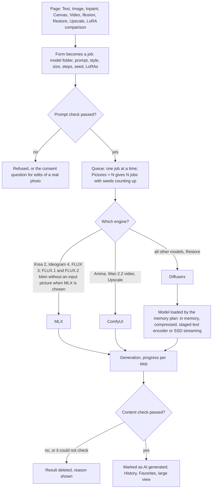

- **Engines** are separate Python processes that read requests on stdin and report progress on stdout. Only one of
  them keeps a model in memory: before another engine starts a job, the previous one unloads its model.
- **MLX or Diffusers**: Krea 2, Ideogram 4 and FLUX 3 Image Klein run only with MLX (FLUX 3 with flux3-mlx, see
  below). FLUX.1 and FLUX.2 [klein] in repository layout run with
  MLX when *Settings → Runtimes* prefers it (or chooses automatically and MLX is installed), but only without an input
  picture and without a control picture. Everything else of these families goes to Diffusers.
- **FLUX 3 Image Klein** (`engines/mlx/flux3.py`) runs with flux3-mlx instead of mflux: it reads Black Forest Labs'
  own files (`model.safetensors`, `ae.safetensors`, `text_encoder/`) or the MLX-quantized repositories made for it. When
  transformer and text encoder do not fit together, the prompt is encoded before the transformer is loaded, so the peak
  is the larger of the two (16 GB Macs: the 6 and 8 bit repositories). LoRAs are put beside its linear layers (also the
  quantized ones), from Black Forest Labs', diffusers' or kohya's names. The optional prompt upsampler (Black Forest
  Labs' flux-3-image-klein-pup, 4 bit, a helper model) runs with mlx-lm before the transformer is loaded and is freed
  again; its caption becomes the job's note. A job with an input picture is not upsampled (that needs the upsampler's
  vision part).
- **The content check** is a long-lived process of the Diffusers runtime. It looks for nudity and estimates the age of
  every face; nudity with a face that is likely a minor is always blocked, any nudity in safe mode. Videos are checked
  on six frames. It **fails closed**: a result it could not check is not shown. Pictures that pass get IPTC/XMP
  metadata saying they are AI generated; ComfyUI marks its videos itself.
- The finished job goes into the **History** with all its settings, so *Use these settings* can bring it back, model
  included.

###  Loading a model: the memory plan

The Diffusers engine never simply loads a model and hopes. Every model has a **memory plan** worked out from the
sizes of its parts: the budget is the Mac's memory minus a reserve (a fifth, at least 4 GB, or the reserve set in
*Settings*), and the plan picks the best quality that fits.

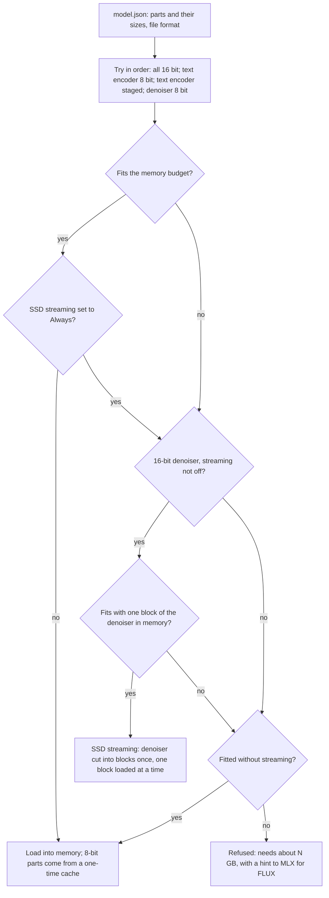

- **Staged text encoder**: the text encoders are loaded only to encode a new prompt and freed before denoising. The
  embeddings are kept, so the same prompt again costs nothing.
- **Compression** with optimum-quanto happens once and is cached next to the model, so later loads are quick. Automatic
  compression goes down to 8 bit; 4 bit comes from GGUF files (or from MLX), whose size is taken as it is.
- **GGUF and FP8**: GGUF files stay packed and are unpacked inside the layers. FP8 checkpoints, which the Apple GPU can
  not compute, become 8-bit GGUF on import. Where a GGUF model does not fit, it streams like a 16 bit one: its
  blocks are unpacked into the streaming cache once (the file is read into memory for that, one time), later
  loads read only the cache.
- **SSD streaming** needs free disk space of about twice the denoiser plus 5 GB for its cache (next to the model, or
  in *Settings → Folders → SSD streaming cache*). The first run shows *Preparing SSD streaming (one-time)*.
- **Large pictures**: the VAE decodes in tiles, SDXL computes attention in slices above about 1536 × 1536, and on
  M1/M2, where bfloat16 is slow, models that allow it compute in float16.

The MLX engine has a plan of its own (mflux, 8 or 4 bit), and ComfyUI keeps the weights as they are and frees the
text encoder when the denoiser needs room.

###  Text to image

1. Open **Text** and choose the **Model** in the panel on the right.
2. Describe the picture. Set **Style**, **Size**, **Steps**, **Guidance**, **Sampler**, **Seed**, **Pictures**, up to
   three **LoRAs** and, where the model has one, **Not in the picture**.
3. Press **Generate** (or ⌘↩). The results appear as tiles under the prompt; a click opens the large view. **×** takes
   a tile out of the list (also a cancelled or failed one), and the pointer on **ⓘ** shows a job's details.

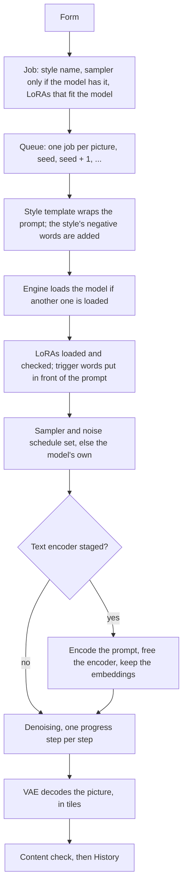

- **Switching the model keeps the settings.** Steps, guidance, seed and size stay, so that models can be compared with
  the same ones; a **!** shows what the new model suggests and **Model defaults** sets it. Only a size the new model
  can not compute changes (in the same proportions) and comes back on a model that can. A chosen sampler stays chosen (a
  model without it runs its default, a **!** says so). LoRAs of another family and a control type the new model
  has not are dropped. The very first model of a page brings all its defaults.
- **Seed**: empty means random. With **Pictures** above 1, the queue makes one job per picture with seeds counting up,
  so every picture of a series can be made again.
- **Styles** live in the job by name; the prompt stays as written, and the engine gets the styled prompt. Models
  without a negative prompt (FLUX) use only the template.
- All image families run here, on the engine chosen above. Inpaint-only models are not offered.

###  Image to image

1. Open **Image** and **Choose a picture** (or drop one onto the field).
2. Describe what the picture should become.
3. Set **Change** (0.05–1). Tick **Own size instead of the picture's proportions** for another size.
4. Press **Generate**.

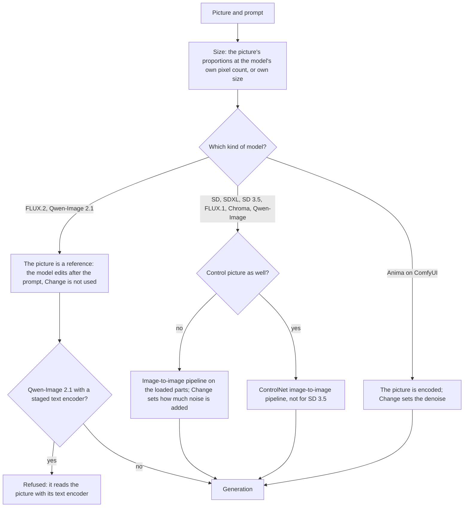

- **Change** is the share of the picture that is noised and painted again: at 0.3 colours and details change, at 0.6
  the motif, above 0.8 little of the picture remains.
- The image pipelines are built on the parts that are already loaded, so switching between Text and Image does not
  load the model again.
- FLUX jobs with an input picture always run with Diffusers, never with MLX.
- A prompt that asks for intimate content from an input picture first asks the **consent question**.

###  Inpainting

1. Open **Inpaint** and choose the picture.
2. **Paint** over the part that is to change (**Erase**, **Size**, undo and the bin help).
3. Describe what should appear there, or leave the prompt empty to remove something.
4. Set **Change** (default 100 %) and press **Generate**.

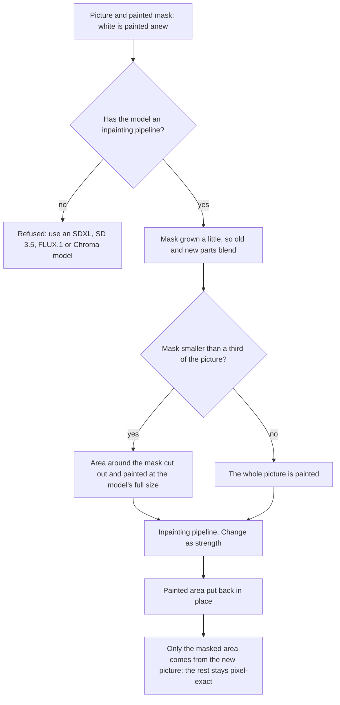

- **Families**: SD 1.x, SD 2.x, SDXL, SD 3.5, FLUX.1, Chroma and Qwen-Image. Older imports without that note in their
  manifest are judged by their family.
- **Small masks** are painted in a cut-out of the picture's proportions, so what the prompt asks for lands in the
  mask instead of somewhere else in the picture.
- **Inpaint-only models** (such as *SD 1.5 Inpainting*) appear only here; a text or image job on them is refused. They
  give the cleanest borders.
- A mask and a control picture can not be combined.

###  AI Canvas

1. Open **Canvas**, **Add a picture** or start in an empty frame.
2. With **Move** (V) drag the orange frame where the next picture belongs, for example half over the edge of a picture.
3. Optionally paint with the **Mask brush** (B) inside the frame.
4. Describe what should appear and press **Generate**. **Export PNG** saves the whole canvas.

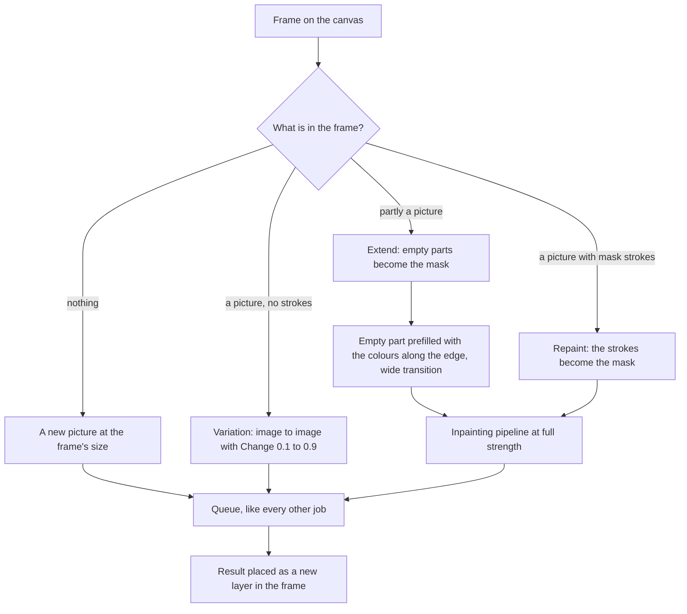

- The start picture is what lies under the frame, with empty parts in neutral grey. When **extending**, every empty
  pixel takes the colour of the nearest picture pixel, strongly blurred, so light and colours continue instead of
  starting from grey; the whole frame is painted, without a cut-out.
- **Models**: all image models except ComfyUI and inpaint-only ones. Extending and repainting need SDXL, SD 3.5,
  FLUX.1, Chroma or another model with an inpainting pipeline; other models paint new pictures only (and variations,
  where they can do image to image). The panel always says what will happen.
- The canvas, with pictures, view, prompt and model, is kept after a restart.

###  ControlNet and pose

**A control picture in Text or Image:**

1. Choose a **Control** kind: Pose, Depth, Edges, Line art, Scribble or Tile (only what the model has is offered).
2. Choose the control picture. Leave **It is a photo: prepare it first** on for a normal photo.
3. Set the **Weight** (0–2) and press **Generate**.

**From the Pose editor:** build people from a **Template**, drag their points, or detect them **From a photo**, then
**Use in Text to image**. The skeleton arrives as a Pose control picture that needs no preparing, together with its
size.

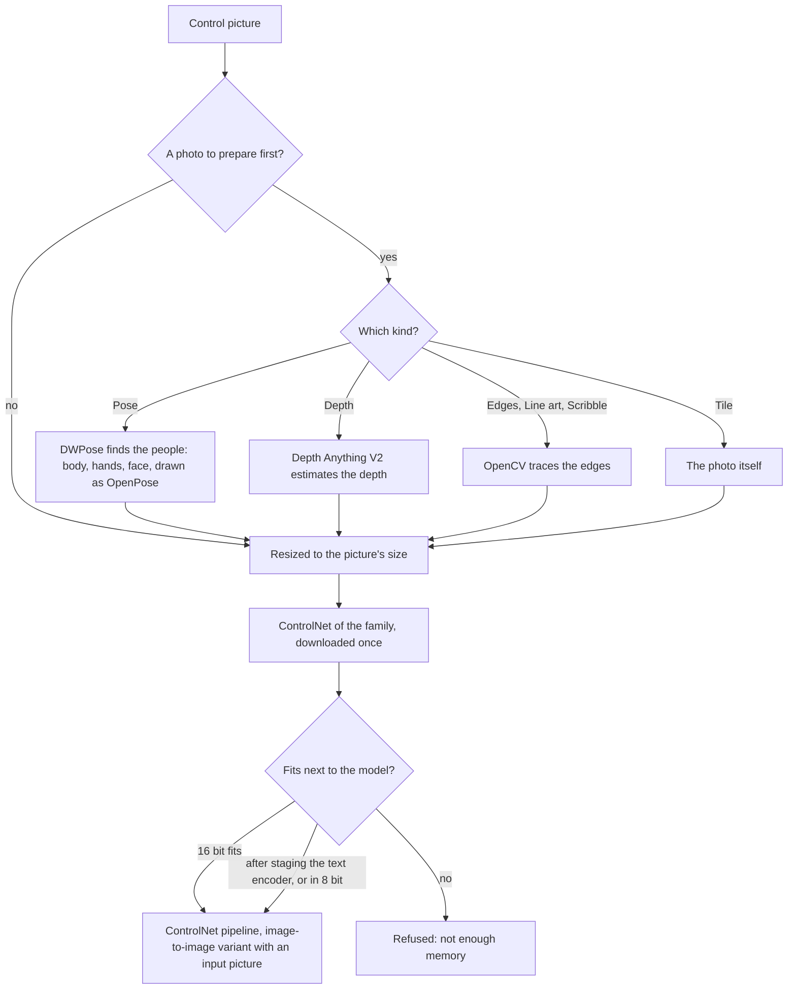

- **ControlNets**: SDXL uses one union model (xinsir ProMax) for all kinds, FLUX.1 the Union Pro 2.0 with its makers'
  recommended scales, SD 1.5 one ControlNet 1.1 per kind, SD 3.5 Medium and Large their own Depth and Canny models (and
  Tile for Large).
- The helper models (DWPose, Depth Anything) are downloaded on first use into the helper folder. The pose editor's
  **From a photo** runs the same DWPose detection through the Diffusers runtime.
- A ControlNet needs memory next to the model: if it does not fit in 16 bit, the engine first stages the text encoder,
  then tries 8 bit (compressed once and cached).

###  Illusion

1. Open **Illusion** and pick a **Hidden pattern**: Spiral, Rings, Checkerboard, Stripes, Text or Own picture; shape
   it with **Density**, **Blur** and **Invert**.
2. Set **Pattern strength** (about 0.8 subtle, 1.2 clear, 1.6 dominant).
3. Describe the picture the pattern hides in and press **Generate**.

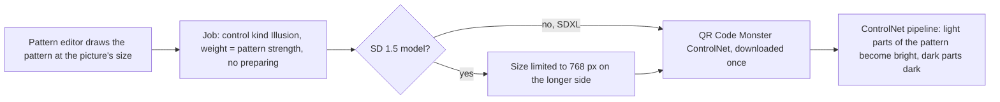

- Only **SDXL** and **SD 1.x** models are offered: the pattern ControlNet (monster-labs QR Code Monster, 5 GB for SDXL,
  v2 for SD 1.5) exists for these two.
- Styles, LoRAs, sampler and seed work as in Text to image.

###  Image to video

1. Install the **ComfyUI** runtime and a **Wan 2.2** model (Models → Recommended).
2. Open **Video**, choose the **Start picture** and describe the movement, camera and mood.
3. Choose **Length** (1–5 s) and **Resolution** (480p or 720p) and press **Generate**.

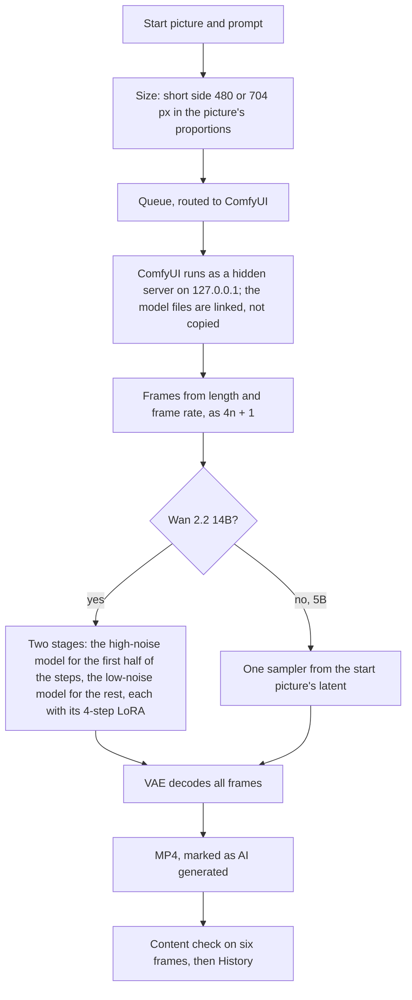

- Video takes far longer than pictures: a one-second clip at 480p took about 8 minutes on an M2 with 24 GB.
- Styles and LoRAs are not used for video; one job makes one clip.

###  Upscale

1. Open **Upscale** (or press **Upscale** in the large view of any picture).
2. Choose the picture (up to 2048 px on its longer side) and **2×** or **4×**.
3. Press **Enlarge**.

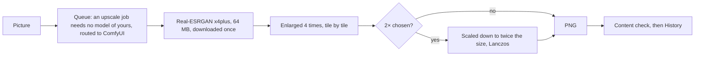

- Real-ESRGAN adds detail instead of blur. ComfyUI's model upscaler works on tiles, so large pictures do not need
  much memory.

###  Restore

1. Open **Restore** and choose the photo. A black-and-white or toned photo is recognised and gets colouring switched on;
   a photo with a colour profile (Display P3, HDR) is converted to sRGB first. The faces are found and shown as frames,
   which can be moved or left out.
2. Pick a **template** (*Black and white, damaged*, *Black and white to colour*, *Colour cast (red or yellow)*, *Faded
   colour photo*, *Only colour it*, *Heavy damage (creases, holes)*, or your own), or choose the steps and their
   strengths yourself.
3. Paint over scratches, creases, spots and holes with the brush, set the guard rails and your own rules, and add a
   note on what the photo shows.
4. Press **Preview** for a part of the photo (compare it with the slider), then **Restore** (or ⌘↩).

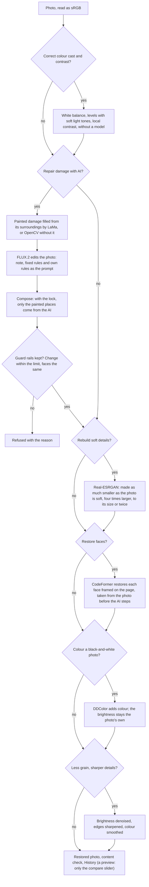

- **Restore always runs with Diffusers.** Correcting, colouring and sharpening need no model of yours; the AI repair
  needs a **FLUX.2** model and refuses others, because it edits the photo instead of painting it anew. Without paint it
  repaints the whole photo: soft clothing and leaves get real detail, which Real-ESRGAN can not make up.
- **Faces** are taken from the photo before the AI steps: the repair may turn faces into other people, and
  Real-ESRGAN's texture would turn into wrinkles. CodeFormer (non-commercial licence) is blended in by its strength.
- **Guard rails**: the fixed rules (only remove damage; keep composition, people, faces, clothing, objects, writing;
  add or invent nothing) plus your own; with **Keep the original outside the painted damage** the result is put
  together from the original and the repaired places only; **Allowed change** (default 6 %) limits how much the shapes
  may change, measured on the blurred brightness so grain and dust do not count; **Refuse results whose faces changed**
  compares the faces found by DWPose before and after (number and position).
- **DDColor** works on the brightness of the photo and returns only colour, so no shape or detail can change. Helper
  models (LaMa, DDColor, Real-ESRGAN, CodeFormer with YuNet) are downloaded once.

###  LoRAs

**Finding and installing:** *Models → Installed*, **LoRAs for a model** searches Civitai and Hugging Face for LoRAs
made for exactly this model's base; **Install** puts one into the import queue. LoRAs can also be added on
*Models → Add* like a model.

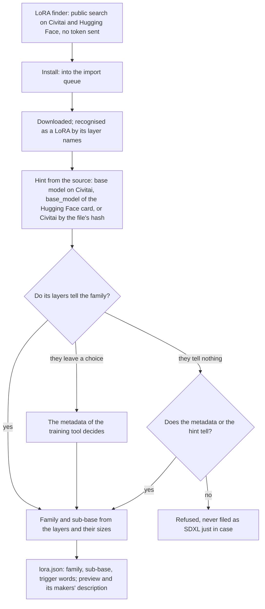

**Using a LoRA:** add up to three in the **LoRAs** section of a generate page, each with its weight; only LoRAs that
fit the chosen model's family and sub-base (FLUX.2 [klein] 4B, 9B, [dev]; Wan 5B, 14B) are offered.

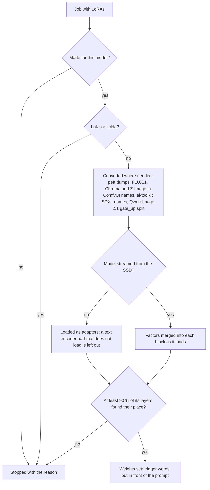

- The **90 % check** counts the LoRA's denoiser layers that really got the adapter (with streaming: matched by name
  and size before anything is generated). A LoRA that only fits the text encoder must have arrived there.
- **Compare strengths** (LoRA page) queues the same prompt and seed at up to eight strengths between −2 and 3; strength
  0 is one picture without any LoRA, and a second LoRA of the same family can be compared alongside.
- The LoRA page shows what the makers' page says (description, recommended settings, example prompts), read once
  and kept as `info.json` next to the LoRA.

**Training:**

1. Open **Training**, give the LoRA a **Name** (the **trigger word** is made from it) and choose the **Model to train on**.
2. **Add pictures** or **Add a folder** (10–30 pictures; `.txt` files of the same name are captions).
3. Choose a **Preset** or set steps, resolution, rank and learning rate, and **Start the training**.

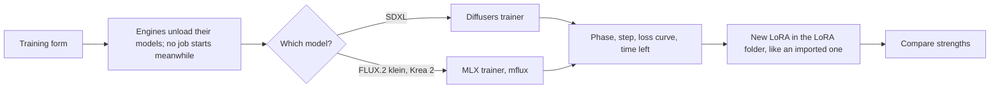

###  Model import

1. Open **Models → Add** and choose the source: **Hugging Face**, **Civitai**, **File** or **Folder**.
2. Enter the repository, link or path (for Hugging Face optionally a **File in the repository**), a **Name** if you
   like, and the compression (*Compress when needed*, *Do not compress*, 8 bit, 4 bit).
3. **Check** shows what it is, the download size and the memory it needs, before anything is downloaded.
4. **Download** or **Import** (**Import anyway** when it needs more memory than the Mac has).

*Models → Recommended* runs the same import for a tested list.

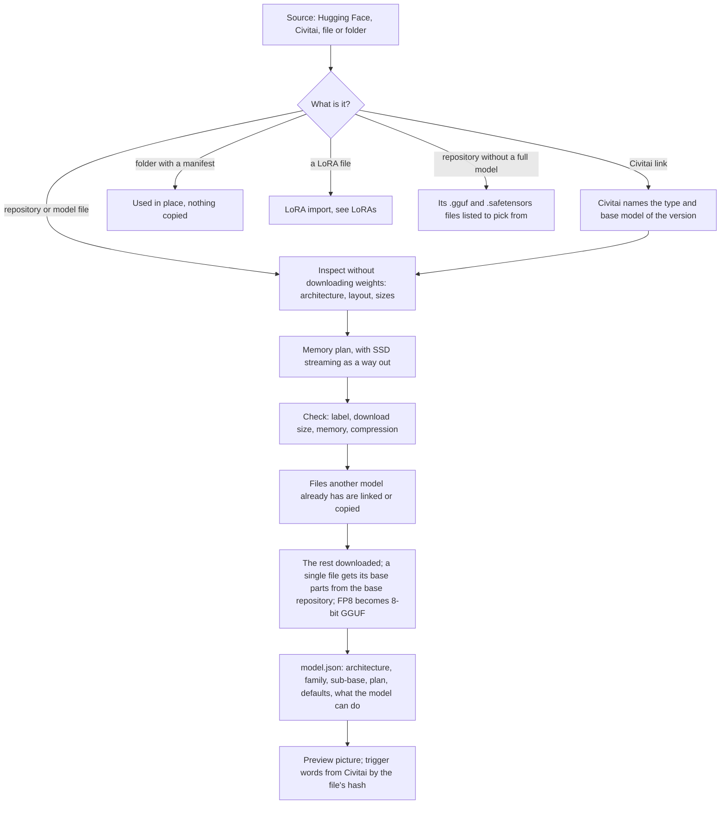

- **Code is never downloaded** from a repository: pipelines come from the installed diffusers and transformers. A
  `.ckpt` is read as plain weights and stored as `.safetensors`.
- **Names**: an import gets the file's name, or the repository's when the file is called `model.safetensors` or the
  like.
- **Reuse**: a file with the same path and size in another imported model (a shared text encoder, for instance) is
  taken from there instead of being downloaded again.
- **At the first load** a single-file model whose base parts are missing gets them (from what is there, else
  downloaded once), an older FP8 import is converted to GGUF once, and a model that streams prepares its block cache
  once.
- **Recheck**: at the first start of a version with a better detection, all installed LoRAs and models are checked
  again offline; a wrong family or a missing sub-base is corrected, and each changed manifest is kept as `.bak`.

###  Privacy in the pipelines

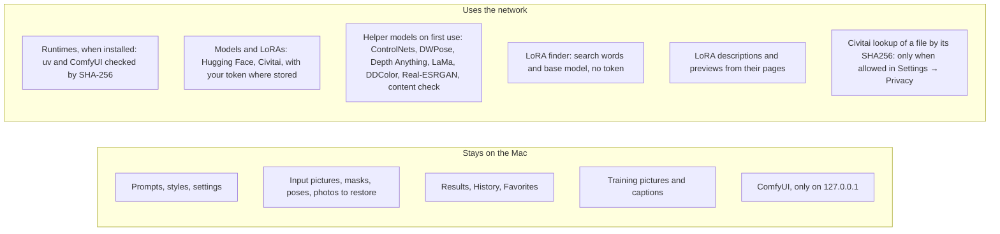

The engines compute everything on the Mac's GPU; no prompt, picture or result is ever sent anywhere. The network is
asked only for what is downloaded, for the LoRA finder and descriptions, for the daily update check of the runtimes
(public version lists; it can be switched off), and, only when allowed in *Settings → Privacy*, for the hash lookup
that finds a file's trigger words and base model on Civitai (it sends the file's checksum, not the file).

- The usage reports of the libraries are off (`HF_HUB_DISABLE_TELEMETRY`, `DO_NOT_TRACK`), and no Hugging Face login
  of the command line is used: a token goes only where the app passes the one stored in *Settings → Access tokens*.
- The MLX engine runs offline; ComfyUI runs offline, writes no prompt into its pictures and loads only the
  ComfyUI-GGUF extension.
- The content filter, LaMa and DDColor are fetched at a fixed commit and checked by their SHA-256; once there, they
  are used without asking Hugging Face again.
- The helper models (content filter, Restore, pose and depth, ControlNets, Real-ESRGAN, photo tools) are listed under
  *Models → Installed → Helpers* with a picture of what each does; they can be downloaded ahead or moved to the Trash,
  and every one is fetched at a fixed commit and checked by its SHA-256.
- Installing a runtime downloads uv at a fixed version and ComfyUI and its GGUF extension at a fixed release and
  commit, each checked by its SHA-256 before anything is installed. The packages themselves come from PyPI over
  HTTPS, within the version ranges of each engine's `requirements.txt` (so that **Update** can follow fixes).
- Folders are set only in the macOS folder dialog, and training pictures pass the content filter before a LoRA
  learns from them.
- A Civitai download link with `?token=…` loses the token before it is used, shown in a log or kept in a model's
  manifest. The LoRA finder asks only
Civitai and Hugging Face over HTTPS, and its preview pictures are fetched by the app itself, since the pages load
nothing from the internet.
